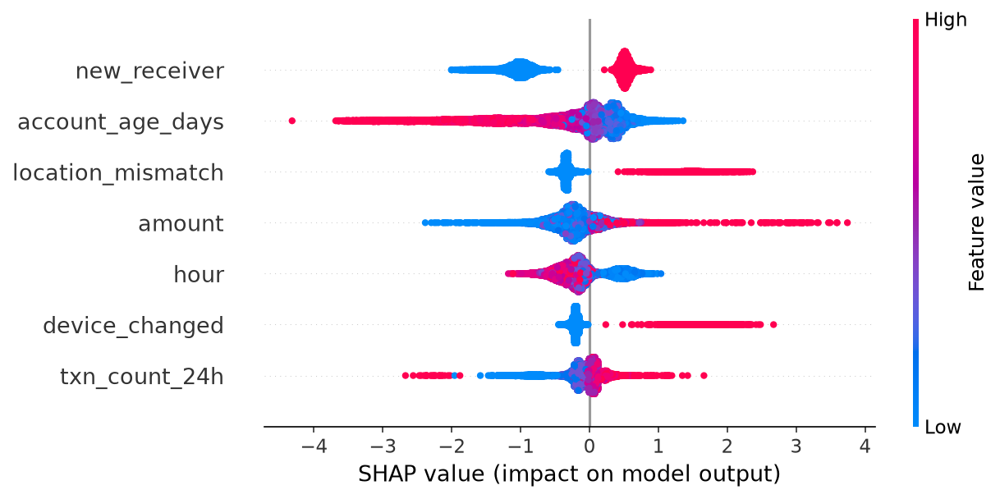
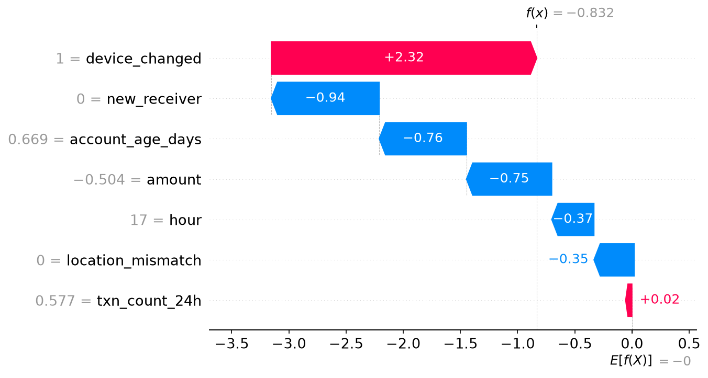

# Explainable ML for UPI and Card Fraud Detection
## Live demo
https://securepay-fraud.streamlit.app/


Fraud detection with XGBoost and SHAP, plus a simulated real-time scoring flow (FastAPI + Streamlit) where users log in, send money, and see why a transaction was approved or blocked.

## Problem
Fraud is rare (0.17% of card transactions in the dataset used here), so accuracy is misleading: a model that predicts "normal" for everything scores 99.8% and catches zero fraud. This project uses Precision, Recall, F1 and PR-AUC, and explains each decision with SHAP.

## Datasets
| Data | Source | Notes |
|---|---|---|
| Card fraud | [Kaggle: Credit Card Fraud Detection (ULB)](https://www.kaggle.com/datasets/mlg-ulb/creditcardfraud) | 284,807 transactions, 492 fraud. Features V1-V28 are anonymized (PCA). |
| UPI fraud | **Synthetic** (`src/generate_upi_data.py`) | 100,000 transactions, ~1.5% fraud, generated from rule-based risk signals. |

> UPI data is synthetic, so UPI results demonstrate the pipeline and explainability, not real-world performance.

## Approach
1. EDA and class imbalance analysis
2. Stratified 80/20 train-test split, scaling fitted on train only
3. Imbalance handled with `class_weight` / `scale_pos_weight`
4. Compared Logistic Regression, Random Forest, XGBoost
5. Explained the best model with SHAP (global and per-transaction)
6. Served the model through a FastAPI endpoint and built Streamlit apps on top

## Results

### Card data (Kaggle)
| Model | Precision | Recall | F1 | PR-AUC |
|---|---|---|---|---|
| Logistic Regression | 0.061 | 0.918 | 0.114 | 0.716 |
| Random Forest | 0.835 | 0.827 | 0.831 | 0.822 |
| **XGBoost** | **0.844** | **0.827** | **0.835** | **0.865** |

Logistic Regression catches most fraud but flags too many normal transactions (precision 0.061), so XGBoost is the best overall.

### UPI data (synthetic)
(Paste your table from `reports/upi_model_results.csv` here)

## Explainability (SHAP)



## Demo apps
| App | Run | What it does |
|---|---|---|
| `app.py` | `streamlit run app.py` | Dashboard: check a transaction, compare models, view SHAP plots |
| `api/main.py` | `uvicorn api.main:app --reload` | FastAPI service: `POST /predict` returns fraud probability and top reasons |
| `api/simulator.py` + `api/live_dashboard.py` | `python api/simulator.py`, `streamlit run api/live_dashboard.py` | Simulated transaction stream and live monitor |
| `user_app.py` | `streamlit run user_app.py` | Login, send money, instant APPROVED/BLOCKED decision with reasons, admin monitor |


## Project structure
```
fraud-detection-xai/
├── api/                # FastAPI service, simulator, live dashboard
├── notebooks/          # EDA and model training (card + UPI)
├── src/                # Synthetic UPI data generator
├── models/             # Trained XGBoost models and scalers
├── reports/            # Result tables and figures
├── app.py              # Analysis dashboard
├── user_app.py         # Login + payment demo
└── requirements.txt
```

## How to run
```bash
git clone https://github.com/Thanu-456/fraud-detection-xai.git
cd fraud-detection-xai
python -m venv venv
venv\Scripts\activate
pip install -r requirements.txt

# Card dataset: download creditcard.csv from Kaggle into data/
python src/generate_upi_data.py      # creates data/upi_synthetic.csv
```
Then run the notebooks in `notebooks/` in order, and start the apps from the table above (start the API before `user_app.py`).

## Limitations
- UPI data is synthetic; real-world performance is not claimed.
- Card features V1-V28 are anonymized, so their SHAP explanations are not human-readable.
- In the payment demo, money is not real, and device change / location mismatch are simulated with checkboxes.
- The real-time flow is a single-machine prototype, not a production system.

## Future work
- Retrain on a larger public transaction dataset (e.g. PaySim)
- Docker packaging and cloud deployment
- Automatic device and location signals, threshold tuning by business cost
- Model monitoring and periodic retraining
